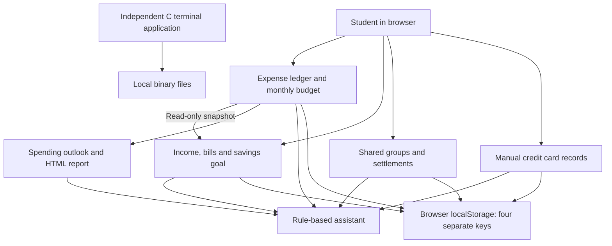

# Campus Ledger: Student Expense and Budget Management System

**Project report — third-year submission**
**Team members:** Divya Jyoti Verma and Lakshya Khasa
**Implementation:** HTML, CSS, JavaScript browser application and an independent C11 terminal application
**Currency:** Indian Rupees (₹)
**Original C course context:** CSET333 — C Programming

Institution, department, roll numbers, academic session, and guide details should be completed using the institution's submission format. This report describes the implemented repository; it does not certify institutional approval.

## Abstract

Campus Ledger is a local student finance application that combines personal expense recording with practical planning tools. Its browser interface supports monthly budgets, income records, upcoming bills, a savings goal, shared hostel or trip expenses, credit card statements and payments, spending comparisons, a simple monthly projection, and a rule-based suggestion assistant. CSV and printable HTML reports support review, while validated JSON backups preserve each module's records.

The project retains its original C terminal application to demonstrate modular programming, structures, enums, a tagged union, dynamic arrays, input validation, and versioned binary file storage. The browser and terminal applications maintain separate data. All financial records are entered manually. There is no bank connection, payment gateway, remote AI service, machine-learning model, or cloud database.

## 1. Problem statement and objectives

Students often receive money from several sources and pay for food, travel, education, rent, and leisure. A spending total alone does not show how much remains after an upcoming bill, whether a saving target is achievable, or how roommates should settle shared purchases. Credit card repayments also need to be distinguished from new spending to avoid counting the same purchase twice.

The project aims to:

1. Make daily expense entry and monthly budgeting easy to use in a browser.
2. Relate received income, recorded expenses, and unpaid bills for the selected month.
3. Make a savings target and its required contribution visible.
4. Split shared bills without losing money through rounding and explain net settlements.
5. Track manually entered card outstanding balances, statement dues, and payments.
6. Explain spending patterns using transparent calculations and local rules.
7. Support reports, backup/restore, validation, and persistent local records.
8. Retain an independently runnable C implementation for core programming concepts.

## 2. Scope and requirements

The primary interface is a responsive, single-user web page. It requires a modern browser with JavaScript, `localStorage`, and standard browser APIs. Python 3 can serve the static files locally. There is no package installation or backend service required for normal browser use. Node.js is optional for running the JavaScript test files.

The terminal implementation requires a C11-compatible compiler and Make. It uses standard C libraries, with small platform-specific branches for directory creation and file replacement. A standard desktop or laptop with sufficient space for source files, exports, and saved records is adequate; this project does not specify an unmeasured minimum RAM or performance guarantee.

Both interfaces use Indian Rupees and operate on manual records. They are educational planning tools, with no authentication, encrypted vault, payment execution, shared online accounts, or automatic statement import.

## 3. Implemented features

### 3.1 Personal expense ledger and budget

An expense contains an ID, description, amount, date, category, and payment label. Users can add, edit, delete, search, filter by category, and sort by date or amount. Nine categories cover Food, Transport, Education, Shopping, Entertainment, Hostel, Mobile & Internet, Healthcare, and Other. Browser payment labels are Cash, UPI, and Card.

The selected month controls the expense total, transaction count, average amount, daily chart, category chart, budget, and planner calculations. The inline budget form saves an individual limit for each month. The dashboard displays utilization and remaining budget, identifies overspending, and distinguishes a zero budget from a budget that has not been set.

### 3.2 Student money planner

Students can record income already received from Allowance, Scholarship, Internship, Part-time work, or Other. Dated bill reminders contain an amount and a paid/unpaid state; overdue unpaid bills are highlighted. Income and bills can be edited or deleted.

For the selected month:

```text
remaining before bills = received income − main-ledger expenses
estimated after bills = received income − main-ledger expenses − unpaid bill amounts
```

This estimate does not contain an opening cash balance, carry-forward money, or balances fetched from a bank. Marking a bill paid changes its reminder state only. Its actual payment should be entered once as an expense, so the estimate does not incorrectly release the reserved money without recording the outgoing amount.

One savings goal stores a name, target amount, amount saved, and deadline. The display shows progress, remaining target, an approximate monthly contribution, and completed or overdue status. The saved amount is manual; it neither transfers money nor reduces the available estimate automatically. A separate daily-saving what-if calculation multiplies a proposed daily amount by a chosen number of days.

### 3.3 Shared hostel and trip expenses

Users can create up to 30 named groups with 2–20 distinct member names. Each shared bill records its description, amount, payer, and date. Every member participates equally; saved member order determines which members receive any extra remainder paise. Membership remains fixed so historical allocations do not change.

The module calculates who owes money and who should receive it, then proposes settlements from debtors to creditors. Users can record a payment already made, including a partial payment. Validation prevents a settlement exceeding either the sender's outstanding debt or the receiver's outstanding credit. Group history preserves bills and settlement entries. Group deletion requires confirmation; there is no individual activity correction interface.

Shared records are local to this browser. They do not invite other members, synchronize devices, send money, or create personal-ledger expenses.

### 3.4 Credit card management

A card record uses a nickname and last four digits, a credit limit, an opening outstanding amount, statement date, unpaid statement amount, minimum payment still due, and payment due date. The screen shows outstanding balance, available credit or over-limit amount, utilization, statement due, minimum due, and overdue/paid status based on the manual records.

Charges and fees increase outstanding balance; recorded payments decrease it. Payments greater than the tracked outstanding balance are rejected. Activity is recorded in date order, and activity after a statement checkpoint cannot predate that statement. Nicknames and limits can be edited. The most recent activity can be undone only if it occurred after the current statement checkpoint.

A new statement stores the amount **still unpaid at the time of entry**, after payments already recorded. A sequence checkpoint prevents those earlier payments from being subtracted twice. Later payments reduce statement and minimum dues; later purchases increase outstanding balance without changing the current statement snapshot.

This module does not calculate interest, predict an issuer's bill, store full card credentials, or initiate payment. Card purchases must also be recorded once in the main ledger if they should appear in expense charts. Repayment should not be counted again as a new purchase expense.

### 3.5 Spending outlook and suggestion assistant

The outlook compares recorded spending across the same number of days in the selected and previous months, using the shorter comparable period when month lengths differ. For the current month, it estimates month-end spending from the recorded daily average through today; future-dated entries are excluded from the pace calculation. A slider shows hypothetical savings from reducing recorded Shopping and Entertainment spending by a chosen percentage.

The suggestion assistant matches keywords to deterministic handlers. It can explain budgets and daily allowance, category totals, planner values, group settlements, card dues, and the spending outlook. Responses use the user's local records. This is a rule-based assistant, not natural-language understanding trained by this project or machine learning. An unrecognized request receives a description of supported topics.

### 3.6 Reports and backups

The browser exports the selected month's personal expenses as CSV and as a standalone HTML report. The HTML report includes budget, total spending, transaction count, category totals, and transaction details. It can be opened in a browser and printed to PDF. It excludes planner income/bills/goals, shared settlements, and independent credit card records.

Each of the four persistent modules has its own JSON backup and validated restore flow. Restore replaces the corresponding module only after confirmation. Users need all four backups to preserve the full browser dataset. CSV and HTML are presentation/reporting formats and cannot restore the full application state.

## 4. Architecture and data model



`app.js` owns the personal ledger and selected month. `ledgerSnapshot()` gives supporting modules a copy of that state, and `ledger-updated` notifies them when they need to recalculate. Modules expose small advice functions for the assistant. Shared bills and credit card activity remain independent to avoid silently changing personal spending.

| Module | Main model | Persistence |
| --- | --- | --- |
| Personal ledger | Transactions and month-keyed budgets | `campus-ledger-v1` |
| Student planner | Income array, bill array, one optional goal | `campus-student-plan-v1` |
| Shared expenses | Named groups with ordered members and bill/settlement history | `campus-split-v1` |
| Credit cards | Card details, opening balance, statement checkpoint, sequenced activity | `campus-ledger-cards-v1` |
| Outlook | Values derived from the ledger snapshot | No separate persistent dataset |

The new planner, split, and card models store money as integer paise. The main expense ledger stores amounts in rupees rounded to two decimals; analysis converts each amount to integer paise before summing. The use of integer paise in split and settlement calculations is essential to balance conservation.

## 5. Core algorithms

### 5.1 Equal split with exact paise

Let `A` be the positive bill amount in paise and `n` the number of members:

```text
base = floor(A / n)
remainder = A mod n
share[i] = base + 1 when i < remainder; otherwise base
```

For ₹100.00 and three members, the shares are ₹33.34, ₹33.33, and ₹33.33. The sum is exactly ₹100.00. Subtract each share from its member's net balance and add the full bill amount to the payer. The sum of all net balances remains zero. A positive balance means money to receive; a negative balance means money owed.

Processing one bill takes O(n) time. Recomputing balances over `b` bills and `s` settlements takes O(bn + s) time with O(n) balance storage. Import validation also replays prior balances to reject invalid settlements, so very long histories cost additional work; group history is limited to 1,000 entries.

### 5.2 Greedy net settlement

Build separate debtor and creditor lists from the net balances. Match the current debtor and creditor for the smaller outstanding amount, reduce both values, and advance whichever reaches zero. Each suggested transfer clears at least one balance, and all suggestions preserve total money.

After balances have been calculated, the matching pass is O(n). With `d` debtors and `c` creditors it produces at most `d + c − 1` transfers when there are outstanding balances. It is a practical valid settlement plan; it does not guarantee the globally minimum number of transfers for every possible set of balances.

A recorded settlement must be positive, use two different group members, and be no greater than `min(sender debt, receiver credit)` at the point it is recorded. This condition prevents a payment from reversing either member's net position.

### 5.3 Linear spending projection and comparison

```text
projected month-end spending = round(recorded month spending through today / elapsed days × month length)
```

The projection is displayed for the current month only. Future-dated entries are excluded from the projection but remain part of the selected month's total and report. Empty records produce an instruction to add expenses, and other months display their recorded total. For a 30-day month with ₹1,000 recorded through day 10, the estimate is ₹3,000. Missing expenses or one-time purchases can make this estimate misleading.

Comparison uses corresponding day numbers in the selected and previous months. For example, a completed 31-day month compared with February uses only their first 28 or 29 days for the comparison. This avoids treating different month lengths as directly equivalent, though it cannot correct for incomplete manual entries.

### 5.4 Savings contribution

```text
remaining = max(0, target − saved)
periods = max(1, ceil(days until deadline / 30))
suggested contribution = ceil(remaining / periods)
```

Amounts are in paise and the contribution is rounded up. The periods are approximate 30-day intervals, not a calendar-month amortization schedule. An unfinished past-deadline goal is marked overdue.

### 5.5 Credit statement checkpoint

```text
outstanding = opening + all charges − all payments
statement still due = max(0, snapshot unpaid statement − payments after checkpoint)
minimum still due = min(statement still due,
                       max(0, snapshot minimum − payments after checkpoint))
```

The sequence checkpoint identifies which payments were already reflected in the entered statement snapshot. Recording a new snapshot updates that checkpoint and prevents undoing activity already included in it.

## 6. Validation and persistence

Forms validate dates, amounts, required names, and collection-specific rules. Imported JSON is checked for its version, expected collections, allowed values, unique identifiers, safe integer money where used, and valid relationships such as settlement limits. Browser-rendered user text is escaped or assigned as text. CSV export quotes fields and guards spreadsheet formula-like values.

Persistence errors are reported, and mutations are rolled back or committed only after storage succeeds. Unreadable saved data is preserved rather than overwritten with a blank dataset; a valid module backup can be restored. These measures address ordinary application errors, not all security threats. `localStorage` remains unencrypted and accessible to scripts running under the same origin.

Storage is scoped to the browser profile, scheme, hostname, and port. The app has no cross-device sync, multi-tab conflict handling, or guaranteed retention after browser data is cleared.

## 7. Original C implementation

The C application is an independent terminal system for expense CRUD, searches, copied-list sorting/filtering, predefined and persistent custom categories, monthly budgets, daily/monthly/yearly and other reports, and monthly text export.

`Expense`, `Transaction`, `Budget`, and `AppState` structures organize records. A `PaymentType` enum selects the active member of the `PaymentDetails` union: a cash note, a UPI identifier, or card last four digits. The union demonstrates shared memory for mutually exclusive fields. Checked dynamic arrays hold transactions, budgets, and custom categories.

Modules divide responsibility among expense operations, budgets, reporting, storage, date handling, validation, and UI. Bounded input uses `fgets`, `strtol`, and `strtod`. Calendar validation includes leap years. ID lookup and aggregation use linear scans, while copied-list bubble sorting takes O(n²) time and O(n) additional storage.

Versioned local files store transaction, budget, and category records. Loading checks headers, counts, sizes, and record validity. Saving writes a temporary file before replacement. Direct binary structure layout is compiler/architecture dependent. Browser and C records are not synchronized, and the new browser planning modules are not available in the C menu.

## 8. Build and operation

From the repository directory, start the browser version:

```sh
python3 -m http.server 8001 --bind 127.0.0.1
```

Open `http://127.0.0.1:8001` in a browser. Use the same address and profile on subsequent visits. On Windows, the equivalent Python command may begin with `py`. Stop the server with `Ctrl+C`.

Build and run the C version:

```sh
make
make run
```

The terminal application creates `data/` and `reports/` as required. Back up those directories separately from browser JSON backups. `make clean` removes build outputs. The README provides file responsibilities, storage keys, and backup instructions.

## 9. Testing and evaluation

Run focused JavaScript checks with Node.js:

```sh
node tests/student-planner.cjs
node tests/split-expenses.cjs
node tests/credit-cards.cjs
node tests/finance-insights.cjs
```

Run the independent C suite:

```sh
make test
```

| Area | Automated checks |
| --- | --- |
| Planner | Paise parsing, date validation, monthly income/expense/bill arithmetic, paid-bill behavior, goal progress/deadline cases, malformed backups |
| Shared expenses | Exact remainder allocation, balance conservation, multiple payers, partial/full settlement, oversettlement and invalid backup rejection |
| Credit cards | Charges and payments, statement/minimum due calculations, snapshot changes, chronology validation, undo restrictions, malformed backups and overpayments |
| Outlook | Paise totals, same-period comparison, different month lengths, future-month suppression, year rollover, exclusion of future-dated expenses from pace |
| C application | Core assertions and isolated CLI smoke cases for validation, budget logic, CRUD/search, persistence, sorting, reports, and input handling |

The focused JavaScript suites pass for the implemented calculations. Integration checks in the browser verified planner totals, shared-expense behavior, and persistence after reload. The latest C verification run passed 42 core checks and 27 smoke checks. These are bounded checks, not a claim that every browser, device, accessibility mode, or financial scenario has been tested.

The accompanying [demo guide](demo_guide.md) provides synthetic data and expected results for a repeatable five-minute presentation.

## 10. Limitations and future enhancements

The application is manual and local. Missing or incorrect entries affect every summary. The planner does not track opening balances or previous-month carry-forward. Bills are date-specific reminders without automatic recurrence. There is one savings goal, all members participate equally in shared bills, membership is fixed, and individual shared activities cannot be edited or deleted. Card corrections are limited by statement checkpoints. The assistant has a finite keyword vocabulary.

There is no cloud database, authentication, encryption, background notification service, bank integration, payment execution, automatic interest calculation, or machine-learning prediction. The app is not an accounting reconciliation system. Its separate modules require deliberate entry conventions and four independent backups. Multi-tab writes are not coordinated.

Potential extensions include unified portable backup, recurring bills, multiple savings goals, unequal/participant-specific splitting, a safer correction workflow for shared histories, automated accessibility checks, and a backend designed around authenticated access and explicit conflict resolution. Bank or payment integrations would require a separate security and authorization design.

## 11. Conclusion

Campus Ledger demonstrates how a small expense tracker can grow into a student-focused planning system with transparent arithmetic, exact shared-money accounting, state validation, persistence, and useful reports. The browser interface supplies a practical workflow while the original C implementation retains the core programming and file-handling learning objectives. Its results remain explainable because they are derived from explicit records and documented formulas.
