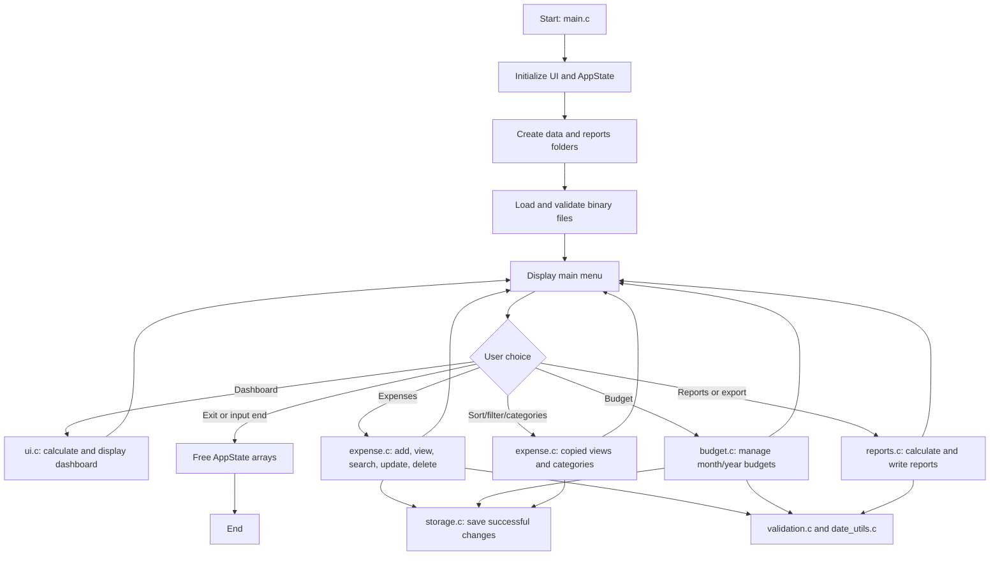

# STUDENT EXPENSE & BUDGET TRACKER USING C
## Student Expense and Budget Management System

### College Project Submission Report

**Course:** CSET333 – C Programming  
**Programming language:** C11  
**Compiler:** GCC  
**Application type:** Menu-driven terminal application  
**Currency:** Indian Rupees (Rs.)

**Submitted by:** [Student Name]  
**Roll / Registration No.:** [Number]  
**Department / Programme:** [Department]  
**Institution:** [College / University]  
**Academic session:** [Academic Year]  
**Project guide:** [Guide Name]

<div style="page-break-after: always;"></div>

## Certificate

This is to certify that **[Student Name]**, Roll / Registration No. **[Number]**, of **[Department / Programme]**, **[Institution]**, has completed the project entitled **“Student Expense and Budget Management System Using C”** as part of the requirements for **CSET333 – C Programming** during **[Academic Session]**.

The work presented in this report is submitted for academic evaluation. The project implementation is a C11 menu-driven application using structures, enumerations, a tagged union, modular functions, input validation, dynamic memory allocation, and local file handling.

| Project guide | Head of Department | External examiner |
| --- | --- | --- |
| Name: ____________________ | Name: ____________________ | Name: ____________________ |
| Signature: _______________ | Signature: _______________ | Signature: _______________ |
| Date: ____________________ | Date: ____________________ | Date: ____________________ |

**Institution seal:** ______________________________

<div style="page-break-after: always;"></div>

## Acknowledgement

I would like to thank **[Project Guide Name]** for guidance and feedback during the development of this project. I also thank the faculty of **[Department / Institution]** for the C programming concepts and laboratory support used in this work.

Finally, I thank my classmates, friends, and family for their encouragement. Any remaining errors in the implementation or this report are my responsibility.

**[Student Name]**  
**[Date]**

<div style="page-break-after: always;"></div>

## Table of Contents

1. [Abstract](#abstract)
2. [Problem statement](#1-problem-statement)
3. [Objectives](#2-objectives)
4. [Scope](#3-scope)
5. [Existing system](#4-existing-system)
6. [Proposed system](#5-proposed-system)
7. [Hardware and software requirements](#6-hardware-and-software-requirements)
8. [System architecture](#7-system-architecture)
9. [Complete program flow](#8-complete-program-flow)
10. [Algorithms](#9-algorithms)
11. [Data structures and union](#10-data-structures-and-union-implementation)
12. [Module descriptions](#11-module-descriptions)
13. [Sample outputs](#12-sample-outputs)
14. [Testing and results](#13-testing-and-results)
15. [Limitations](#14-limitations)
16. [Future scope](#15-future-scope)
17. [Conclusion](#16-conclusion)

<div style="page-break-after: always;"></div>

## Abstract

The Student Expense & Budget Tracker is a local, menu-driven application written in C11. It helps a student record expenses, organize them by category and payment method, set monthly budgets, and review calculated financial summaries. Implemented operations include adding, viewing, searching, updating, deleting, sorting, and filtering expense records. The program also provides daily, monthly, yearly, category, payment-method, high/low, budget, and financial summary views. A monthly report can be exported as a text file.

The application uses `Expense`, `Transaction`, `Budget`, and `AppState` structures; enums for predefined categories and payment types; and a `PaymentDetails` union whose active member is selected by `PaymentType`. It validates numeric input and calendar dates, dynamically allocates its collections, and stores records in local versioned binary files. The project demonstrates modular C programming and file handling. It is an educational, single-user tracker and does not connect to a bank or provide bank-grade security.

## 1. Problem statement

Students make frequent purchases for food, transport, education, housing, communication, health, and other activities. When purchases are not recorded consistently, a student may have difficulty identifying where money is spent or comparing monthly spending with a planned budget.

This project addresses that problem with a local program that records transactions and calculates summaries from the saved records. The report describes the implemented source code, not a proposed banking or accounting service.

## 2. Objectives

1. Record expenses with date, category, description, amount, and payment method.
2. Find records by ID, date, category, amount, payment method, or description text.
3. Update or delete transactions with user confirmation.
4. Set and view budgets for month/year pairs.
5. Calculate monthly spending, remaining budget, and utilization.
6. Display a dashboard and budget status based on loaded data.
7. Generate financial reports and a monthly text export.
8. Sort and filter a copy of the data without changing saved transaction order.
9. Store expense, budget, and custom category data locally.
10. Demonstrate C structures, enums, a union, functions, pointers, dynamic arrays, validation, and file handling.

## 3. Scope

The program is a single-user terminal application. It runs offline and stores data relative to its current working directory in `data/`; monthly text exports are written to `reports/`. It supports nine predefined expense categories—Food, Transport, Education, Shopping, Entertainment, Hostel/Rent, Mobile/Internet, Healthcare, and Other—plus custom categories. Payment methods are Cash, UPI, and Card.

Implemented user operations include expense CRUD, searches, budgets, reports, sorting/filtering, category listing and custom category addition, and monthly text export. There is no bank integration, external database, login system, encryption, CSV export, or category rename/delete screen in the current source.

## 4. Existing system

In a basic manual approach, a student may write purchases in a notebook or keep an informal spreadsheet. Such records can be useful but may not automatically calculate monthly totals, remaining budget, or category/payment summaries. This section describes the general problem context; it does not claim that a particular existing product was evaluated.

## 5. Proposed system

The implemented program provides one menu for expense entry, review, search, update/delete, monthly budget management, reports, sorting/filtering, custom category management, and text export. Records are loaded at startup and modifications are saved to local files. The dashboard and reports calculate values by scanning the application’s transaction array.

## 6. Hardware and software requirements

### Hardware

- A desktop or laptop capable of running a GCC toolchain and terminal application.
- Keyboard and terminal access.
- Available memory for the selected transaction history and disk space for the executable, data files, and report exports.

### Software

- C11-compatible GCC compiler.
- GNU Make or a compatible `make` utility.
- macOS or Windows with a GCC toolchain such as MinGW. The Windows-specific directory creation and file replacement code exists in `storage.c`; a Windows build was not part of the recorded test run.
- Standard C libraries only; no external database or third-party C package.

Build and run from the project directory:

```sh
make
make run
```

Run tests using `make test`.

## 7. System architecture

`main.c` owns the `AppState`, loads files, displays the menu, and dispatches operations. Expense, budget, and report modules use shared validation, date, storage, and UI services.



### Persistent files

| Path | Stored data |
| --- | --- |
| `data/expenses.dat` | Versioned header and `Transaction` records |
| `data/budgets.dat` | Versioned header and `Budget` records |
| `data/categories.dat` | Versioned header and fixed-size custom category names |
| `reports/monthly_report_YYYY_MM.txt` | Human-readable monthly report export |

## 8. Complete program flow

1. Initialize `AppState` and set the first candidate ID to 1.
2. Initialize the terminal UI and show the welcome screen.
3. Ensure the `data/` and `reports/` directories exist.
4. Load the versioned binary files. Validate their headers, counts, sizes, and records before using them.
5. Display the main menu and read a bounded, validated choice.
6. Dispatch the choice to the corresponding module.
7. For a modifying operation, validate input and request confirmation where appropriate.
8. Save successful changes using a temporary file and rename replacement; restore the in-memory value when an expense or budget save fails.
9. Return to the menu until the user exits or input ends.
10. Free the dynamic arrays before exiting.

## 9. Algorithms

### Add expense

```text
Find an unused positive ID
Read and validate date, category, description, amount, and payment method
Clear PaymentDetails and collect only the member selected by PaymentType
Display the proposed transaction
If confirmed:
    reserve array capacity
    append the transaction
    save the full expenses file through a temporary file
    if saving fails, decrement the in-memory count
```

### Calculate monthly spending

```text
total = 0
for each transaction:
    parse its DD-MM-YYYY date
    if parsed month and year match the selected period:
        total += transaction amount
```

Remaining budget is `budgetAmount - monthlySpending`. Utilization is monthly spending divided by a positive budget, multiplied by 100. Dashboard and budget summary treat a zero budget as utilization unavailable. In the monthly report, a zero budget is labeled “Zero budget” and its displayed utilization placeholder is 0.00%.

### Search

Search scans the transaction array linearly. ID/date/category/amount/payment searches compare the chosen field. Description search checks for a case-insensitive partial substring.

### Sort and filter

The program copies the transaction array, then uses Bubble Sort for amount, date, category name, or ID ordering. Date comparison parses the year, month, and day. Filters fill and display a separate array of matches. These views do not rewrite the stored transaction order. Bubble Sort uses O(n²) comparisons and is intended for an undergraduate demonstration dataset.

## 10. Data structures and union implementation

### `Expense`

`Expense` stores the integer ID, `DD-MM-YYYY` date string, `ExpenseCategory`, optional custom category label, description, and `double` amount.

### `Transaction`

`Transaction` combines an `Expense`, its `PaymentType` tag, and `PaymentDetails` union.

### `Budget`

`Budget` holds month, year, and budget amount. A month/year pair identifies a budget; setting the same pair updates it.

### `AppState`

`AppState` owns dynamically allocated arrays for transactions, budgets, and custom category names. It tracks count and capacity for each array and the next candidate expense ID. The code checks each `realloc` result and frees arrays through `appStateFree()`.

### Enums

`ExpenseCategory` names the nine built-in categories and includes `CATEGORY_COUNT` as an array bound. `PaymentType` names Cash, UPI, and Card and acts as the union tag.

### Union example

```c
typedef union {
    char upiId[PAYMENT_DETAIL_SIZE];
    char cardLastFourDigits[5];
    char cashNote[PAYMENT_DETAIL_SIZE];
} PaymentDetails;
```

`choosePayment()` assigns the tag and clears the union before collecting an optional UPI ID, four card digits, or an optional cash note. Code checks `paymentType` before reading a payment detail. The union reserves shared storage for one alternative; a structure would reserve space for all member arrays at once. The program does not request PINs, CVVs, or full card numbers, and the UI does not display payment detail values.

## 11. Module descriptions

| Module | Description |
| --- | --- |
| `main.c` | Program entry, state initialization/loading, menu dispatch, exit cleanup |
| `common.h` | Shared limits, enums, structs, and public helper declarations |
| `expense.c/.h` | Expense CRUD, searches, table listing, sorting/filtering, categories, array allocation helpers |
| `budget.c/.h` | Budget add/update/view, monthly expense/remaining calculations, alert classification |
| `reports.c/.h` | Daily/monthly/yearly/category/payment/high-low/summary output and monthly text export |
| `storage.c/.h` | Directory creation, versioned binary load/save, record validation, temporary-file replacement |
| `validation.c/.h` | Bounded input, number parsing/range checks, required and optional strings |
| `date_utils.c/.h` | Leap year, parse/compare/format date, local current date |
| `ui.c/.h` | Welcome/menu/section/dashboard/table/status presentation; optional ANSI color |
| `Makefile` | Compile, run, clean, and test targets |

## 12. Sample outputs

The following examples were captured by running the current executable in an isolated directory. Two transactions were entered for November 2026—Rs. 125.50 for lunch and Rs. 40.00 for bus fare—and a Rs. 200.00 budget was set. These values are demonstration input for this report; they are not built into the program. No screenshots are claimed or included.

### Dashboard sample

```text
|                       STUDENT FINANCE DASHBOARD                        |
  Reporting period: 11-2026

  MONTHLY BUDGET
  Current month spending        Rs. 165.50
  Monthly budget                Rs. 200.00
  Remaining budget              Rs. 34.50
  Budget utilization            82.75%
[INFO] Budget status:
[WARNING] Warning: approaching budget limit

  SPENDING OVERVIEW
  Lifetime expenses             Rs. 165.50
  Total transactions            2
  Transactions this month       2
  Highest expense               Rs. 125.50
  Lowest expense                Rs. 40.00
  Average transaction           Rs. 82.75
  Most frequent category        Food
  Most used payment method      Cash
```

### Expense table sample

```text
+------------+------------+--------------------+------------------------------+--------------+----------+
| ID         | DATE       | CATEGORY           | DESCRIPTION                  | AMOUNT (Rs.) | PAYMENT  |
+------------+------------+--------------------+------------------------------+--------------+----------+
| 1          | 20-11-2026 | Food               | Lunch at campus              |       125.50 | Cash     |
| 2          | 20-11-2026 | Transport          | Bus fare                     |        40.00 | UPI      |
Showing 1-2 of 2 | Page total: Rs. 165.50
Total records: 2 | Lifetime total: Rs. 165.50
```

### Monthly report/export sample

```text
STUDENT EXPENSE TRACKER — MONTHLY REPORT
Generated: 20-11-2026
========================================

Monthly Expense Report — 11-2026
Transactions: 2
Total spending: Rs. 165.50
Highest expense: ID 1, Lunch at campus, Rs. 125.50
Average expense: Rs. 82.75

Category totals:
  Food                   1  Rs. 125.50
  Transport              1  Rs. 40.00

Payment totals:
  Cash       1  Rs. 125.50
  UPI        1  Rs. 40.00
  Card       0  Rs. 0.00

Budget: Rs. 200.00
Remaining: Rs. 34.50
Utilization: 82.75% (Warning: approaching budget limit)

Transactions:
ID 1 | 20-11-2026 | Food               | Lunch at campus                  | Rs. 125.50 | Cash
ID 2 | 20-11-2026 | Transport          | Bus fare                         | Rs. 40.00 | UPI
```

## 13. Testing and results

The project’s current test suite was run from the project directory with `make test`. Recorded results:

- **42 core checks passed; 0 failed.** These cover date/leap-year behavior, category indexing, ID lookup, budget calculations/status thresholds, tagged-union persistence, custom category persistence, and duplicate-ID rejection.
- **27 isolated CLI smoke checks passed.** These cover input validation, add/update/delete/search flows, sorting, reporting/export, restart persistence, missing/corrupt files, zero budgets, dashboard/table presentation, and plain/ANSI output.
- A prior full run with AddressSanitizer and UndefinedBehaviorSanitizer also passed the core and CLI checks.
- The duplicate-ID loader diagnostic printed during the core suite is expected: that test deliberately writes a duplicate-ID fixture and verifies that loading rejects it.

The test-case table is in `docs/test_cases.md`. Test runs use temporary directories for CLI data so they do not overwrite user records. The sample outputs above were captured in a separate isolated run.

## 14. Limitations

- The program is local and single-user; it has no login, synchronization, encryption, or bank connection.
- Binary files contain raw C structures and are intended for compatible compiler/architecture builds rather than arbitrary interchange.
- Bubble Sort has O(n²) time complexity and can be slow for large histories.
- Custom categories can be listed and added; the current UI does not rename or delete them.
- The program exports monthly text reports; CSV export is not implemented.
- ANSI colors are opt-in through the environment. Plain text is the default and is supported.
- Windows-specific code exists but was not covered by the recorded build/test environment.

## 15. Future scope

Possible future improvements, not current features, include a portable field-by-field or CSV data format, optional CSV report export, a date-range report, category archiving with reference checks, configurable budget warning thresholds, and faster sorting for large histories. Any persistent structure change should include a file format version update or migration plan.

## 16. Conclusion

The Student Expense & Budget Tracker is an undergraduate C programming project that applies structures, enums, a tagged union, pointers, dynamic arrays, modular functions, validation, date handling, and file processing to a practical expense-tracking problem. The current implementation records and analyzes local transactions, manages monthly budgets, and creates reports. The report describes implemented behavior and clearly separates sample-run inputs and future ideas from built-in features.
